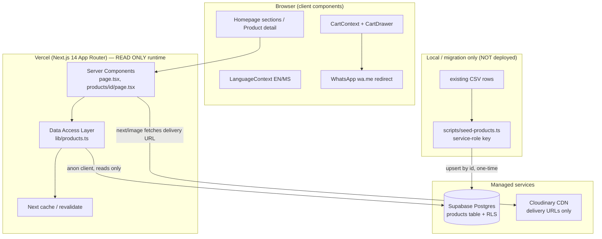
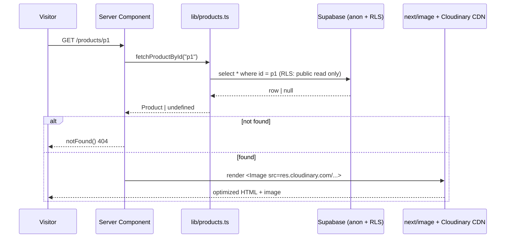
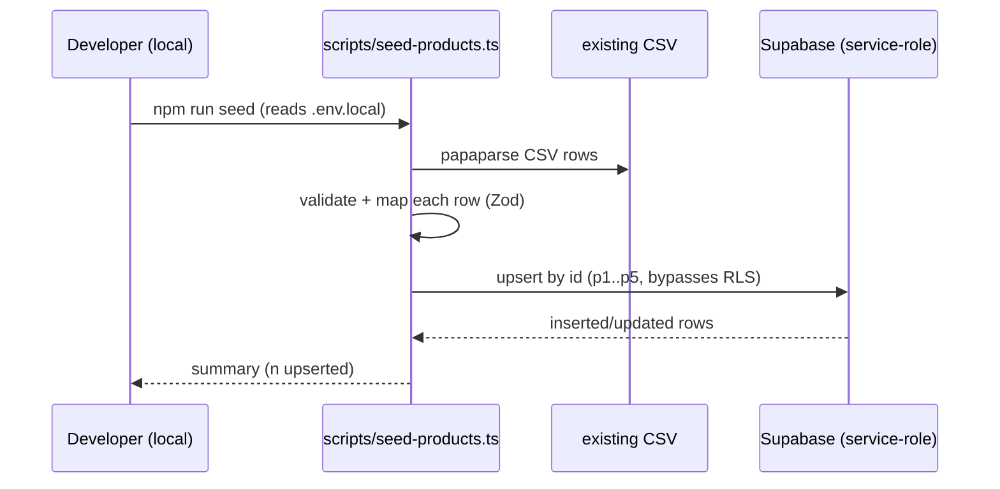
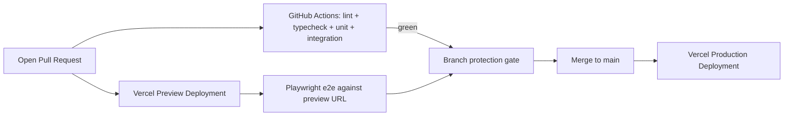

# Design Document: Production Stack Migration

## Overview

This migration moves the FATRAH batik-bag catalog off its current static architecture (Google Sheets CSV with a hardcoded fallback in `lib/csv-parser.ts`, no database, no media pipeline) onto a production-grade stack: **Supabase (PostgreSQL)** for data, **Cloudinary** for media delivery, and **Vercel + GitHub** for CI/CD with preview deployments. The goal is to showcase modern DevOps, full-stack, and automated-testing skills while keeping the visible product behavior identical.

The site is a **catalog-only, read-only public site with manual content updates**. There is no admin UI and no Supabase Auth. Product rows are edited by hand in the Supabase dashboard; product images are uploaded by hand in the Cloudinary dashboard and their `res.cloudinary.com` delivery URL is pasted into the product row. The only automated write path in the whole system is a one-time **seed script** run locally (or during migration) — it never runs in the deployed Vercel runtime. The deployed app only ever *reads*.

The design is deliberately conservative about *behavior*: the WhatsApp (`wa.me`) ordering flow, the bilingual EN/MS UI, the made-to-order 2–4 week messaging, and the homepage section composition all stay exactly as they are. What changes is the *source of truth* and the *infrastructure underneath*. The `Product` shape that components already depend on is preserved as a stable contract; Supabase becomes the authoritative store, the existing CSV becomes a one-time seed, and a new typed data-access layer replaces `csv-parser.ts` behind the same function signatures (`fetchProducts`, `fetchProductById`).

Because the app is read-only, **no API routes and no server actions are needed** — pages are server components that call the data-access layer directly. The "why" is threaded through each section because the user has a mentor-minded, QA-driven lens: every architectural choice calls out its tradeoff, its failure mode, and what you would test. Security gets special attention around `.env` handling — specifically the hard boundary between the server-only/seed-only service-role key and the browser-exposed `NEXT_PUBLIC_` anon key. The headline security win of the catalog-only model: **the service-role key is never present in the Vercel runtime environment at all** — it lives only in `.env.local` and is used only by the seed script — so the running app holds nothing but a read-only anon key, backstopped by Row Level Security.

---

## Architecture



**Key boundaries:**

- **Reads** flow through server components into a single data-access layer (`lib/products.ts`) using the Supabase **anon** client. This is the only runtime path to Supabase. Reads are cached so browsing rarely hits the database.
- **Media**: images are uploaded **manually via the Cloudinary dashboard**. The product row stores the resulting `res.cloudinary.com` delivery URL as plain text. At runtime, `next/image` simply fetches/optimizes that URL — the app never calls the Cloudinary API and holds no Cloudinary credentials.
- **Writes** happen exactly once, out of band, through the **seed script** using the service-role key on a developer's machine. The deployed runtime has no write path.

No API routes or server actions exist, because there are no runtime mutations to expose or secure.

---

## Sequence Diagrams

### Public read (product detail page) — the only runtime data path



### One-time seed (local / migration, not deployed)



---

## Components and Interfaces

### Component 1: Data Access Layer — `lib/products.ts`

**Purpose**: Single source of truth for reading products from Supabase. Replaces `lib/csv-parser.ts` while preserving its public function signatures so callers (`app/page.tsx`, `app/products/[id]/page.tsx`) do not change.

**Interface**:

```typescript
// Preserves the existing call sites verbatim.
export async function fetchProducts(): Promise<Product[]>;
export async function fetchProductById(id: string): Promise<Product | undefined>;

// New: explicit, testable mapping from DB row to the UI contract.
export function mapRowToProduct(row: ProductRow): Product;
```

**Responsibilities**:
- Create/reuse the Supabase **anon** client (read-only against RLS).
- Query the `products` table, ordered deterministically (by `sort_order`).
- Map snake_case DB rows to the camelCase `Product` contract via `mapRowToProduct`.
- Apply Next.js caching so the common browsing path rarely hits the database.
- Never throw to the page for a "not found" or transient error; return `[]` / `undefined` (fail-soft, mirroring the current fallback behavior).

### Component 2: Supabase Anon Client — `lib/supabase/anon.ts`

**Purpose**: Centralize read-client creation. This is the only Supabase client present in the deployed runtime.

**Interface**:

```typescript
// lib/supabase/anon.ts — safe for RSC reads; uses NEXT_PUBLIC_ anon key.
export function createAnonClient(): SupabaseClient<Database>;
```

**Responsibilities**:
- Build the anon client from `NEXT_PUBLIC_SUPABASE_URL` + `NEXT_PUBLIC_SUPABASE_ANON_KEY`.
- Typed with a generated `Database` type for end-to-end type safety.
- There is deliberately **no admin/service-role client module in the app** — the service-role key never ships to the runtime. The only service-role usage lives in the seed script (Component 3).

### Component 3: Seed Script — `scripts/seed-products.ts`

**Purpose**: One-time migration of the existing fallback CSV (and current Google Sheet rows) into Supabase. This is the **only** place the service-role key is used, and it runs locally / at migration time, **never** in the deployed runtime.

**Responsibilities**:
- Parse the known CSV columns with `papaparse` (reusing the existing parsing knowledge).
- Validate/normalize each parsed row with a Zod schema (`SeedRowInput`) so a malformed CSV fails loudly before any write.
- Upsert rows using the service-role client (loaded from `.env.local`), preserving existing `id` values (`p1`–`p5`) so existing URLs and `generateStaticParams` output remain stable.
- Idempotent: upsert on `id` so re-running does not duplicate.

**Security note**: because seeding is out of band, the service-role key exists only in `.env.local` on the developer machine and is **never** added to any Vercel environment. The deployed app therefore cannot mutate data even in principle.

---

## Data Models

### Model 1: `products` table (Supabase PostgreSQL)

```sql
create table public.products (
  id            text primary key,            -- preserve existing "p1".."p5"
  name          text not null,
  description_en text not null,
  description_ms text not null,
  price         text not null,               -- kept as display string e.g. "RM 480" (see rationale)
  bg            text not null,               -- hex accent used by UI
  grid_class    text not null,               -- Tailwind layout classes
  aspect_class  text not null,
  image_url     text not null,               -- Cloudinary delivery URL, pasted in manually
  sort_order    integer not null default 0,  -- deterministic ordering
  created_at    timestamptz not null default now(),
  updated_at    timestamptz not null default now()
);
```

**Validation Rules**:
- `id`, `name`, `description_en`, `description_ms`, `price`, `bg`, `grid_class`, `aspect_class`, `image_url` are all `NOT NULL`.
- `price` is stored as the display string (`"RM 480"`) to preserve the exact current `Product` contract and avoid a behavior change in `CartContext` price parsing. *Rationale / tradeoff:* a numeric `price_cents` column would be cleaner for arithmetic, but changing the contract now would ripple into `CartContext.totalPrice` parsing and the WhatsApp message formatting. We keep the string contract in this migration and note numeric pricing as a follow-up.
- `bg` must match `^#([0-9a-fA-F]{6})$`.
- `image_url` must be an `https://` URL (manually pasted from the Cloudinary dashboard; typically on `res.cloudinary.com`).

> There is no `image_public_id` column: the app never deletes or re-derives Cloudinary assets at runtime, so it only needs the delivery URL. Asset lifecycle is managed by hand in the Cloudinary dashboard.

### Model 2: TypeScript types

```typescript
// The UI contract — unchanged from lib/csv-parser.ts, re-exported from lib/products.ts
// so every existing import of `Product` keeps working.
export interface Product {
  id: string;
  name: string;
  descriptionEn: string;
  descriptionMs: string;
  price: string;        // display string, e.g. "RM 480"
  bg: string;
  gridClass: string;
  aspectClass: string;
  imageUrl: string;
}

// Generated DB row shape (via `supabase gen types typescript`). Snake_case mirrors Postgres.
export interface ProductRow {
  id: string;
  name: string;
  description_en: string;
  description_ms: string;
  price: string;
  bg: string;
  grid_class: string;
  aspect_class: string;
  image_url: string;
  sort_order: number;
  created_at: string;
  updated_at: string;
}
```

> No `ActionState` type exists: the discriminated server-action result contract was removed along with the mutation actions. Pages consume `Product` / `Product[]` directly.

### Model 3: Row Level Security (RLS) policies

```sql
alter table public.products enable row level security;

-- Public (anon) may read everything. No insert/update/delete policy exists for anon,
-- so those are denied by default even with a leaked anon key.
create policy "public_read_products"
  on public.products for select
  using (true);

-- No write policies at all. The only writer is the seed script using the service-role
-- key, which bypasses RLS and runs locally — never in the deployed runtime.
```

**Why RLS matters here:** defense-in-depth. The anon key is shipped to the browser (`NEXT_PUBLIC_SUPABASE_ANON_KEY`) and must be assumed public. RLS guarantees that key can only ever *read*. If the anon key leaks (it will — it's in the bundle), there is no write path through it. Combined with the service-role key being absent from the runtime, the deployed app has no mutation capability whatsoever.

---

## Algorithmic Pseudocode

### `fetchProducts` — cached read with deterministic mapping

```typescript
ALGORITHM fetchProducts()
INPUT: none
OUTPUT: Product[]  (possibly empty, never throws for "empty")

BEGIN
  client ← createAnonClient()
  { data, error } ← AWAIT client
                        .from('products')
                        .select('*')
                        .order('sort_order', { ascending: true })
                        // cached read; browsing rarely hits the DB
  IF error THEN
    LOG error
    RETURN []                      // fail soft: the catalog renders empty, not a 500
  END IF
  RETURN data.map(mapRowToProduct)
END
```

**Preconditions:**
- Supabase env vars (`NEXT_PUBLIC_SUPABASE_URL`, `NEXT_PUBLIC_SUPABASE_ANON_KEY`) are present at runtime.
- RLS `public_read_products` policy is enabled.

**Postconditions:**
- Returns an array of valid `Product` objects ordered by `sort_order`.
- On DB error, returns `[]` and logs — never throws to the page layer (mirrors the current fail-soft fallback behavior).

**Loop Invariants:**
- During `map`, every already-mapped element satisfies the `Product` contract (all required string fields present).

### `fetchProductById` — single lookup

```typescript
ALGORITHM fetchProductById(id)
INPUT: id : string
OUTPUT: Product | undefined

BEGIN
  ASSERT id ≠ ""
  client ← createAnonClient()
  { data, error } ← AWAIT client.from('products').select('*').eq('id', id).maybeSingle()
  IF error OR data = null THEN
    RETURN undefined               // page layer decides notFound()
  END IF
  RETURN mapRowToProduct(data)
END
```

**Preconditions:** `id` is a non-empty string.
**Postconditions:** Returns a `Product` iff a row with that `id` exists and is readable; otherwise `undefined`. No side effects.
**Loop Invariants:** N/A (no loop).

### `seedProducts` — one-time CSV → Supabase upsert (local only)

```typescript
ALGORITHM seedProducts(csvText)
INPUT: csvText : string (existing CSV content)
OUTPUT: count of upserted rows

BEGIN
  rows ← papaparse(csvText, { header: true })
  admin ← createServiceRoleClient()          // from .env.local, LOCAL ONLY
  FOR each raw IN rows DO
    parsed ← SeedRowInput.safeParse(raw)
    ASSERT parsed.success                     // malformed CSV fails the seed loudly
  END FOR
  payload ← rows.map(toRow)                   // preserve id p1..p5
  { data, error } ← AWAIT admin.from('products').upsert(payload, { onConflict: 'id' }).select()
  ASSERT error = null
  RETURN data.length
END
```

**Preconditions:**
- Runs locally / during migration with `SUPABASE_SERVICE_ROLE_KEY` present in `.env.local`.
- Never executed in the deployed Vercel runtime.

**Postconditions:**
- Each CSV row exists in `products` keyed by its original `id`; re-running is idempotent (upsert on `id`).
- Invalid input aborts before writing (no partial/garbage rows from a malformed field).

**Loop Invariants:**
- During validation, every already-checked row satisfies `SeedRowInput` before any write occurs.

---

## Key Functions with Formal Specifications

### `mapRowToProduct(row)`

```typescript
function mapRowToProduct(row: ProductRow): Product
```

**Preconditions:** `row` has all non-null required fields per the DB `NOT NULL` constraints.
**Postconditions:** Returns a `Product` whose camelCase fields equal the corresponding snake_case row fields; `price` and `imageUrl` are passed through unchanged. Pure function — no I/O, no mutation of `row`.
**Loop Invariants:** N/A.

### `SeedRowInput` (Zod) — seed-script input validation

```typescript
// Used ONLY by scripts/seed-products.ts to validate parsed CSV rows before upsert.
export const SeedRowInput = z.object({
  id: z.string().min(1),
  name: z.string().min(1),
  descriptionEn: z.string().min(1),
  descriptionMs: z.string().min(1),
  price: z.string().regex(/^RM\s?\d+(\.\d{2})?$/),
  bg: z.string().regex(/^#([0-9a-fA-F]{6})$/),
  gridClass: z.string().min(1),
  aspectClass: z.string().min(1),
  imageUrl: z.string().url(),
});
export type SeedRowInput = z.infer<typeof SeedRowInput>;
```

**Preconditions:** Called with a parsed CSV record (object of string fields).
**Postconditions:** On success, yields a validated row safe to upsert; on failure, surfaces field errors so the seed aborts before writing. Pure validation — no I/O.
**Loop Invariants:** N/A.

---

## Example Usage

```typescript
// app/products/[id]/page.tsx — call sites are UNCHANGED after migration.
import { fetchProducts, fetchProductById } from '@/lib/products'; // was '@/lib/csv-parser'

const product = await fetchProductById(params.id);
if (!product) notFound();

// app/page.tsx — homepage still just fetches and composes.
const products = await fetchProducts();
```

```javascript
// next.config.mjs — whitelist Cloudinary alongside the existing Unsplash host.
images: {
  remotePatterns: [
    { protocol: 'https', hostname: 'images.unsplash.com' },      // existing seed images
    { protocol: 'https', hostname: 'res.cloudinary.com' },       // manually uploaded media
  ],
}
```

---

## Correctness Properties

### Property 1: Contract stability
∀ product `p` returned by `fetchProducts`/`fetchProductById`, `p` satisfies the exact `Product` interface the UI already consumes (same field names and string types). *(Protects every existing component.)*

**Validates: Requirements 2.5, 2.6, 3.1, 3.2, 3.3, 3.4, 3.5**

### Property 2: Read-only anon
∀ request authenticated by the anon key, no row in `products` is created, updated, or deleted (RLS invariant).

**Validates: Requirements 5.2, 5.3, 5.4, 5.5**

### Property 3: Secret containment
∀ bundle shipped to the browser and ∀ Vercel runtime env, there is no service-role key and no Cloudinary secret. Only `NEXT_PUBLIC_`-prefixed values (`SUPABASE_URL`, `SUPABASE_ANON_KEY`) appear in the runtime.

**Validates: Requirements 9.1, 9.2, 9.3, 9.4, 9.5**

### Property 4: Fail-soft reads
∀ transient DB read error, `fetchProducts` returns `[]` rather than throwing (preserves current resilience where the site always renders).

**Validates: Requirements 10.1, 10.2, 10.4**

### Property 5: Preserved behavior
The WhatsApp `wa.me` order flow, EN/MS translations, and 2–4 week made-to-order messaging are unchanged by this migration.

**Validates: Requirements 11.1, 11.2, 11.3, 12.1, 12.2, 12.3**

---

## Error Handling

### Scenario 1: Supabase read error (transient)
**Condition**: Network blip or Supabase unavailable during a public read.
**Response**: `fetchProducts` logs and returns `[]`; `fetchProductById` returns `undefined` → page shows `notFound()`.
**Recovery**: Next request retries; cached values serve during the window if present.

### Scenario 2: Missing environment variable
**Condition**: A required public var is absent at runtime (e.g. misconfigured Vercel env), or the service-role key is missing when running the seed script locally.
**Response**: The relevant client factory throws a clear error naming the missing var; the runtime/seed fails loudly rather than silently using an undefined key.
**Recovery**: Set the variable in the correct scope (`.env.local` for the seed; Vercel env for the runtime) and retry.

### Scenario 3: Image host not whitelisted
**Condition**: A Cloudinary URL is stored but `res.cloudinary.com` is not in `remotePatterns`.
**Response**: `next/image` throws at render for an unconfigured host.
**Recovery**: Add the host to `next.config.mjs` (covered in this migration).

### Scenario 4: Malformed CSV during seed
**Condition**: A CSV row fails `SeedRowInput` validation (bad `price`, bad `bg` hex, non-URL `imageUrl`, missing field).
**Response**: The seed script aborts before any upsert, reporting the offending row and field.
**Recovery**: Fix the CSV source and re-run the (idempotent) seed.

---

## Environment Variable Strategy

The hard rule: **anything prefixed `NEXT_PUBLIC_` is compiled into the client bundle and must be treated as public.** Everything else is server-only. In this catalog-only model there is a second, stronger boundary: **secrets are not merely server-only, they are seed-only** — they live in `.env.local` and are used by the seed script, and are **never added to any Vercel environment**.

| Variable | Scope | Where used | Notes |
|---|---|---|---|
| `NEXT_PUBLIC_SUPABASE_URL` | Public (Vercel runtime) | anon client | Project URL, safe to expose. |
| `NEXT_PUBLIC_SUPABASE_ANON_KEY` | Public (Vercel runtime) | anon client (reads) | Public by design; RLS makes it read-only. |
| `SUPABASE_SERVICE_ROLE_KEY` | **Local / seed-only** | seed script | Bypasses RLS. In `.env.local` only. **Never set in Vercel.** |
| `GOOGLE_SHEETS_CSV_URL` | **Local / seed-only** | seed script (optional source) | Legacy source; used once for seeding, then unneeded. |

**Vercel runtime needs only two variables:** `NEXT_PUBLIC_SUPABASE_URL` and `NEXT_PUBLIC_SUPABASE_ANON_KEY`. That's the whole runtime surface. No Cloudinary variable is required at runtime: images are referenced by their full `res.cloudinary.com` delivery URL stored in the row, so the app never needs a cloud name or any Cloudinary credential.

**`.env.local` (local dev / seeding)** holds the public pair **plus** the seed-only `SUPABASE_SERVICE_ROLE_KEY` (and optionally `GOOGLE_SHEETS_CSV_URL`), with real values, and is git-ignored. Provide a committed **`.env.example`** listing the names (no values) so the required set is discoverable.

**Server-only vs `NEXT_PUBLIC_` boundary (explicit):**
- `NEXT_PUBLIC_*` → compiled into the browser bundle; assume public. Only the Supabase URL and anon key qualify.
- No-prefix (`SUPABASE_SERVICE_ROLE_KEY`, `GOOGLE_SHEETS_CSV_URL`) → never read by any shipped module. In this project they are only read by `scripts/seed-products.ts`, which is not part of the deployed bundle.

**Security win:** because the service-role key is seed-only and absent from Vercel, the deployed app physically cannot perform a privileged write. The attack surface for data mutation is reduced to a developer's local machine.

---

## CI/CD: Vercel + GitHub Flow



- **GitHub → Vercel integration** auto-builds every push. Each PR gets an isolated **Preview Deployment** with its own URL, wired to the Preview-scoped env vars (ideally a separate Supabase project/branch so previews never touch production data).
- **GitHub Actions** runs on every PR: `lint` → `tsc --noEmit` (strict) → unit tests → integration tests. **Branch protection** blocks merge unless checks pass.
- **E2E** (Playwright) runs against the live Vercel Preview URL so tests exercise the real deployed stack, not a local mock.
- **Production** deploys automatically on merge to `main`. Rollback is a one-click redeploy of a previous Vercel build.
- **Why previews matter here:** they turn "works on my machine" into "works on a real URL with real managed services," and give QA a stable link to test each change in isolation before it reaches production.

---

## Testing Strategy

Layered so each test targets the cheapest level that can meaningfully catch the defect.

### Unit tests (Vitest) — pure logic, no network
**What to test:**
- `mapRowToProduct`: snake_case → camelCase mapping, including `price`/`imageUrl` passthrough.
- `SeedRowInput` (Zod): accepts valid input; rejects bad `price` format, bad `bg` hex, non-URL `imageUrl`, empty required fields (table-driven edge cases).
- WhatsApp message formatting (EN and MS variants) — guards the preserved order flow.

### Integration tests (Vitest) — against a real Supabase (test project/branch)
**What to test:**
- `fetchProducts` returns rows ordered by `sort_order`; returns `[]` on simulated error.
- `fetchProductById` returns a `Product` for an existing id and `undefined` for a missing one (hit/miss).
- RLS: an anon client **can** select but **cannot** insert/update/delete (expect a permission error) — this enforces P2/P3, not just asserts them in prose.

### End-to-end tests (Playwright) — against the Vercel Preview URL
**What to test:**
- Homepage renders the product grid from Supabase data.
- Product detail page loads, shows EN + MS descriptions, and the made-to-order 2–4 week note.
- Language toggle switches every visible string EN ↔ MS.
- Add-to-cart updates the cart drawer count and total.
- "Order via WhatsApp" builds a `wa.me` URL whose prefilled text contains the product name and quantity (assert the generated URL; do not navigate to WhatsApp).

**Property-based testing (optional, fast-check):** generate arbitrary valid `ProductRow`s and assert `mapRowToProduct` always yields a `Product` satisfying the contract (P1), and that field values are preserved through the mapping.

**Coverage intent:** the data-access layer holds the correctness and security invariants, so it is the highest-value unit/integration target. UI presentational components are covered indirectly by e2e.

---

## Security Considerations

- **Secret boundary** is the headline win. The service-role key is *seed-only* — it lives in `.env.local` and is used by `scripts/seed-products.ts`, and is never added to any Vercel environment. The deployed runtime therefore carries only `NEXT_PUBLIC_` values, so there is no privileged credential to leak and no runtime write path (P3).
- **RLS as a backstop** (P2): the anon key is public by nature; policies make it read-only, and no write policy exists, so a leaked anon key cannot mutate data.
- **No admin surface, no auth needed**: content is edited manually in the Supabase and Cloudinary dashboards (protected by those vendors' own account auth), so there is no application auth/role logic to build or get wrong.
- **No runtime media credentials**: images are consumed as plain `res.cloudinary.com` delivery URLs via `next/image`; the app never calls the Cloudinary API, so no Cloudinary secret exists anywhere in the project's runtime.
- **No payment surface** is introduced — the WhatsApp redirect remains the only conversion path, which also keeps PCI scope at zero.

---

## Performance Considerations

- **Cached reads**: public reads are cached, so the common path (browsing) rarely hits the database.
- **Cloudinary + next/image**: images are served from Cloudinary's CDN and optimized again by `next/image` at the edge — fast first paint, small payloads. Applying `f_auto,q_auto` transforms at upload time (in the Cloudinary dashboard) keeps delivered bytes small.
- **Static generation preserved**: `generateStaticParams` still enumerates product ids at build; detail pages stay statically optimized.

---

## Dependencies

**Runtime (new):**
- `@supabase/supabase-js` — Postgres client (anon reads only, in the runtime).

**Dev / tooling (new):**
- `vitest` + `@testing-library/react` — unit/integration tests.
- `@playwright/test` — end-to-end tests against preview URLs.
- `supabase` CLI — `gen types typescript`, local/test project management.
- `zod` — validates CSV rows inside the seed script.
- (optional) `fast-check` — property-based tests.

**Retained:** `next` 14, `react` 18, `typescript` 5 (strict), `tailwindcss` 3, `papaparse` (seed script only).

**Removed from runtime after migration:** `GOOGLE_SHEETS_CSV_URL` fetch path and the hardcoded fallback CSV in `lib/csv-parser.ts` (CSV logic survives only in the one-time seed script). No `cloudinary` SDK and no `server-only` guard module are needed, since the app performs no media uploads and holds no server-only secrets at runtime.
